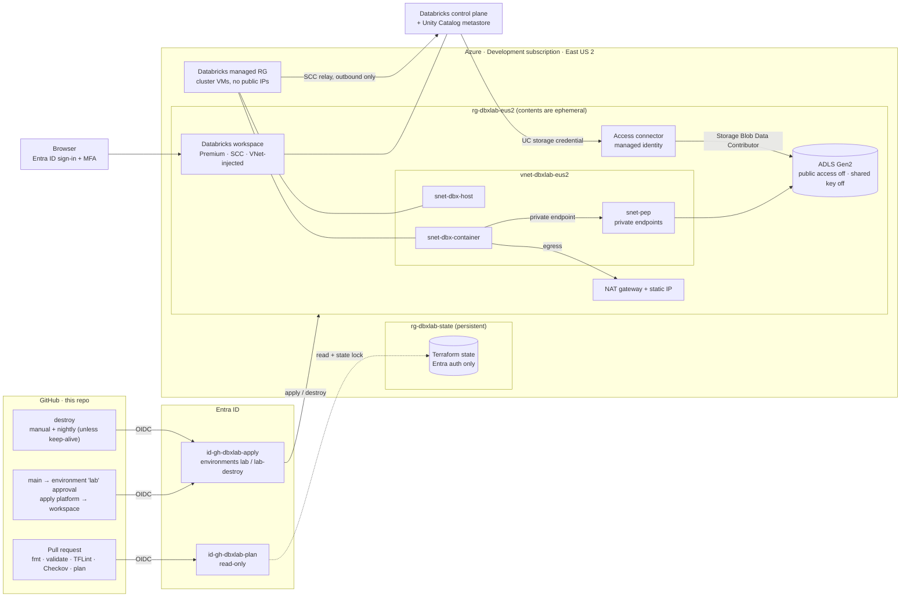

# Azure Databricks platform lab

A small, **private-by-default, keyless** Azure Databricks platform, deployed
entirely from Terraform through GitHub Actions and torn down when it isn't
being used.

> **Personal lab build.** This is how I (Colin Shanahan) design, build, and
> explain a data platform while learning Databricks. It processes only public
> data and doesn't claim production Databricks experience.
> Portfolio: **[colinshanahan.dev](https://www.colinshanahan.dev)**.

**Status: Phase 1 in progress** (Terraform workspace, networking, identity,
CI/CD). Nothing is deployed yet. See [Roadmap](#roadmap).

## What it proves

| Claim | Evidence in this repo |
|---|---|
| Terraform at scale | Split roots (`bootstrap` / `platform` / `workspace`), reusable modules, remote state with Entra-only auth, plan on every PR |
| Azure networking | VNet injection, secure cluster connectivity (no public IPs on nodes), NAT gateway egress, private endpoints and private DNS for ADLS |
| Identity without secrets | GitHub OIDC to user-assigned managed identities, a Unity Catalog access connector (managed identity) to storage, ABAC-conditioned role assignment rights |
| Databricks governance | Premium workspace, Unity Catalog storage credential / external location / catalog / schemas / grants, a cluster policy that enforces node size, auto-termination and tags |
| CI/CD with gates | `fmt` / `validate` / TFLint / Checkov on every PR, plan from a read-only identity, apply behind a GitHub environment approval, nightly destroy |
| Cost control | $25/month budget with alerts, ephemeral-by-default operation, tags everywhere |
| Later phases | Python lakehouse pipeline with pytest (phase 2), keyless Azure OpenAI from Databricks (phase 3) |

## Architecture



- **Control plane vs compute plane.** Databricks runs the web app, job
  scheduler and Unity Catalog in its own control plane. Cluster VMs run in a
  Databricks-managed resource group in my subscription, attached to my VNet,
  with no public IPs. They dial *out* to the control plane; nothing dials in.
- **Data path.** Clusters reach the internet only through the NAT gateway, and
  reach ADLS only through private endpoints. Unity Catalog hands clusters
  short-lived storage access through the access connector's managed identity.
- **Deploy path.** GitHub's OIDC token is exchanged for an Entra token on a
  managed identity. No secret is stored anywhere.

The full design, including the trade-offs I didn't build (front-end Private
Link, IP access lists, Key Vault), is in the
[design doc](https://github.com/cjshanahan1228/colinshanahan.dev-portfolio/blob/main/docs/design/databricks-platform-lab.md).

## Operating model and cost

**Ephemeral by default, with an interview-week keep-alive.** The lab is
deployed when I need it and destroyed every night, unless the
`LAB_KEEP_ALIVE_UNTIL` repository variable holds a date up to 7 days ahead.

Estimates are East US 2 pay-as-you-go list prices from 2026-10-06 (see the
design doc for the line items):

| | Cost |
|---|---|
| One 4-hour working session (infra + single-node compute) | ≈ $2.75–$4.50 |
| One full day (~8 h) | ≈ $5.40–$8.45 |
| Idle between sessions (state account only) | < $1 / month |
| Always-on, for comparison | ≈ $57–$68 / month |
| Budget alert cap | **$25 / month** (50 %, 80 %, 100 % actual, 100 % forecast) |

The biggest standing cost is the NAT gateway (~$0.045/h), which is why the lab
isn't left running. Measured deploy and destroy times will be recorded here in
phase 1.

## Repository layout

```
infra/
  bootstrap/   applied locally once by me: state account, CI identities, budget
  platform/    azurerm, ephemeral: network, NAT, ADLS + private endpoints, workspace
  workspace/   databricks provider, ephemeral: Unity Catalog objects, cluster policy
  modules/     network, lakehouse-storage, databricks-workspace, unity-catalog
.github/workflows/
  ci.yml       pull requests: fmt, validate, TFLint, Checkov, plan
  deploy.yml   main / manual: plan, approval, apply
  destroy.yml  manual + nightly destroy
docs/
  learning/    my learning notes per phase
```

## Roadmap

- [ ] **Phase 1:** Terraform workspace, networking, identity, CI/CD *(in progress)*
- [ ] **Phase 2:** Python lakehouse pipeline (bronze / silver / gold Delta) as a bundle, with pytest in CI
- [ ] **Phase 3:** Azure OpenAI summarization through a keyless Unity Catalog service credential
- [ ] **Phase 4:** Write-up on [colinshanahan.dev](https://www.colinshanahan.dev)

Tracking issue: [colinshanahan.dev-portfolio#61](https://github.com/cjshanahan1228/colinshanahan.dev-portfolio/issues/61).

## License

[MIT](LICENSE)
